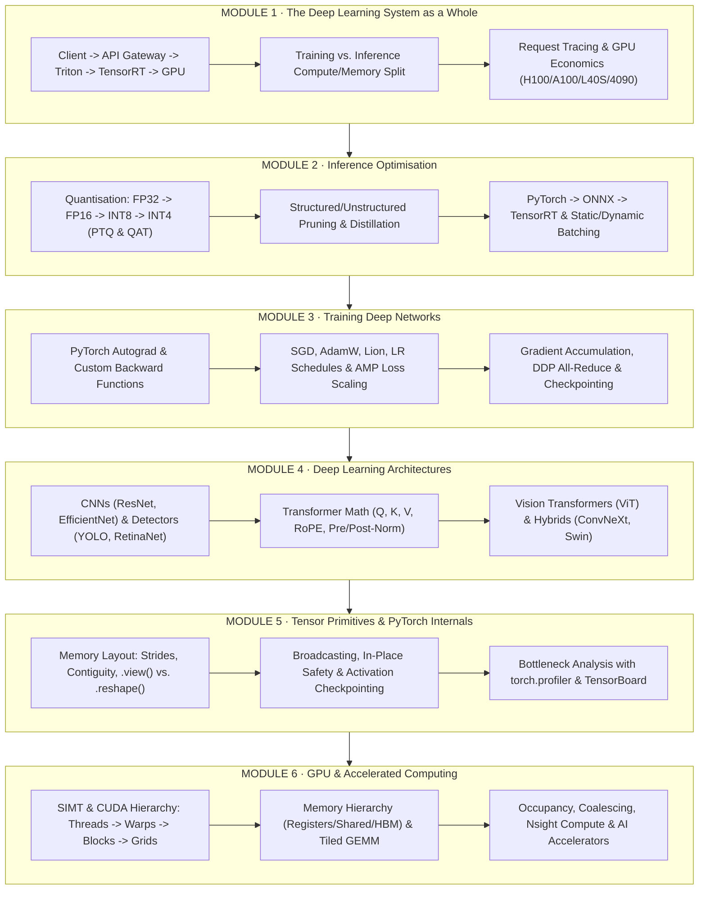

# ⚡ Deep Learning with Accelerated Computing
### `25CS3112E` · Complete Course Syllabus & Systems Learning Roadmap

[-B45309?style=for-the-badge)](#)

  <em>Engineering deep-learning systems at scale—connecting neural architectures, inference optimisation, multi-GPU distributed training, PyTorch tensor internals, and CUDA GPU programming.</em>

---

[What You Will Learn](#what-you-will-learn) •
[Tech Stack](#tech-stack) •
[Curriculum Map](#curriculum-map) •
[Core Models](#core-models) •
[6 Core Modules](#syllabus) •
[Course Outcomes](#outcomes) •
[48 Skilling Labs](#skilling-labs) •
[24 Lectures](#lectures) •
[Evaluation](#evaluation) •
[Resources](#resources)

> [!IMPORTANT]
> **Course Scope & Engineering Philosophy:** Deep learning at scale is what happens when representation learning meets a throughput processor. This course focuses on **deep-learning systems depth and GPU-accelerated computing**—connecting model accuracy directly to hardware constraints such as latency, throughput, GPU VRAM, power, and compute cost. *(Detailed LLM platform engineering and embedded/edge AI live in their respective downstream courses.)*

---

## ✨ What You Will Learn

Rather than treating neural networks as hardware-agnostic scripts, this course teaches you to engineer, profile, and optimize every layer of a deep-learning stack—from the HTTP serving layer down to the GPU warp:

| Pillar | Core Competencies & Systems Engineering Skills |
| :--- | :--- |
| **1. End-to-End DL Systems** | Analyze a production deep-learning service as a layered stack (`Client` → `API Gateway` → `Triton` → `TensorRT` → `GPU`), separate training from inference workloads, trace request latency end-to-end, and reason about GPU cloud economics (`H100`, `A100`, `L40S`, `RTX 4090`). |
| **2. Inference Optimisation** | Optimize latency, throughput, memory, and power via precision reduction (`FP32` → `FP16` → `INT8` → `INT4`), **PTQ** & **QAT**, structured/unstructured pruning, teacher–student distillation, `PyTorch` → `ONNX` → `TensorRT` compilation, kernel fusion, and dynamic/continuous batching. |
| **3. Multi-GPU Training at Scale** | Master PyTorch's dynamic autograd engine and custom backward functions; configure **SGD+Momentum**, **AdamW**, and **Lion** with warmup/cosine/one-cycle schedules; stabilize **AMP** (`FP16`/`BF16` + `FP32` master weights + loss scaling); and scale via **DDP** (`all-reduce`) and resumable checkpointing. |
| **4. Modern Neural Architectures** | Analyze CNNs (**ResNet**, **EfficientNet**), object detectors (**Faster R-CNN**, **YOLO**, **RetinaNet**), Transformer blocks at mathematical depth ($Q, K, V$, **RoPE**, pre-norm vs. post-norm), **Vision Transformers (ViT)**, and modern hybrids (**ConvNeXt**, **Swin Transformer**). |
| **5. Tensor Primitives & Profiling** | Write zero-overhead PyTorch code by mastering device placement, broadcasting rules, row-major memory strides, contiguity, `.view()` vs. `.reshape()`, autograd-safe functional ops, activation checkpointing, and bottleneck tracing with `torch.profiler` & TensorBoard. |
| **6. GPU & CUDA Computing** | Program GPUs directly using the **SIMT** model, CUDA thread hierarchy (`threads` → `warps` → `blocks` → `grids`), GPU memory hierarchy (`registers`, `shared SRAM`, `L1/L2`, `global HBM`), tiled **GEMM** vs. `cuBLAS`, coalesced access, occupancy, **Nsight Compute**, and AI accelerators. |

---

## 🛠️ Accelerated Computing & Deep Learning Stack

| Domain | Core Frameworks & Tools | Concepts, Primitives & Targets |
| :--- | :--- | :--- |
| **Deep Learning & Training** |   | `autograd` · `AMP` · `GradScaler` · `DDP` · `AdamW` · `Lion` |
| **Compilation & Serving** |    | `PTQ` · `QAT` · `INT8 / FP16` · `Kernel Fusion` · `Dynamic Batching` · `vLLM` |
| **GPU & Kernel Programming** |   | `SIMT` · `Warps (32)` · `Shared SRAM` · `Tiled GEMM` · `Coalescing` |
| **Profiling & Observability** |   | `Occupancy` · `Warp Divergence` · `Memory vs. Compute Bound` |
| **Hardware & Accelerators** |   | `H100` · `A100` · `L40S` · `RTX 4090` · `TPU` · `MI300` · `Cerebras` · `Groq` |

---

## 🗺️ Curriculum Architecture Map

---

## 📐 Core Quantitative Relations Covered

| Concept / Mechanism | Mathematical Relation | Engineering Purpose |
| :--- | :--- | :--- |
| **Affine Quantisation** | $q = \text{clip}\!\left(\text{round}\!\left(\frac{x}{s}\right) + z,\; q_{\min},\; q_{\max}\right)$ | Mapping `FP32` activations/weights to `INT8` using scale $s$ and zero-point $z$ |
| **Effective Batch Size** | $B_{\text{eff}} = B_{\text{micro}} \times N_{\text{accum}} \times N_{\text{GPU}}$ | Scaling training batch size across gradient accumulation steps and `DDP` replicas |
| **Scaled Dot-Product Attention** | $\text{Attention}(Q, K, V) = \text{softmax}\!\left(\frac{QK^T}{\sqrt{d_k}}\right)V$ | Core Transformer sequence/patch mixing with variance-stabilizing $\sqrt{d_k}$ scaling |
| **Row-Major Stride Offset** | $\text{offset}(i, j) = i \cdot s_0 + j \cdot s_1$ | Reasoning about zero-copy tensor views, transposes, and `.contiguous()` requirements |
| **1D CUDA Thread Index** | $\text{idx} = \text{blockIdx.x} \times \text{blockDim.x} + \text{threadIdx.x}$ | Mapping data-parallel array elements onto GPU threads with bounds checking |
| **Throughput-per-Dollar** | $\eta_{\text{cost}} = \frac{\text{Throughput}}{\text{Hourly GPU Cost}}$ | Comparing `H100`, `A100`, `L40S`, and `RTX 4090` economics (`queries/sec/$`) |

---

## 📚 Detailed Module-Wise Syllabus

### 🔹 Module 1 · The Deep Learning System as a Whole (`CO1`)
> **Focus:** Seeing a production deep-learning service end-to-end, contrasting training vs. inference, and evaluating GPU hardware economics.

* **Canonical System Stack:** End-to-end architecture from `Client` → `API Gateway` → `Triton Inference Server` → `Optimised Model (TensorRT Engine)` → `GPU` → `Response`.
* **Training vs. Inference Split:** Orders-of-magnitude differences in compute, memory footprint, latency SLAs, and optimization objectives.
* **Deep-Learning Lifecycle at Scale:** Data pipelines, model architecture definitions, training loops, evaluation harnesses, optimization scripts, and serving configurations.
* **End-to-End Request Tracing:** Tracing one HTTP inference request through validation, image preprocessing, tensor batching, TensorRT execution, GPU kernels, postprocessing, and bounding-box serialization.
* **GPU Economics:** Architectural and cost comparison across **NVIDIA H100, A100, L40S, and consumer RTX 4090**; hourly cost and throughput-per-dollar (`queries/sec/$`) reasoning.

### ⚡ Module 2 · Inference Optimisation (`CO2`)
> **Focus:** Compressing, compiling, and batching neural networks to meet strict latency, throughput, VRAM, and power budgets.

* **The Inference-Cost Equation:** Engineering trade-offs across latency, throughput, GPU memory, and thermal power draw.
* **Quantisation:** Precision scaling (`FP32` → `FP16` → `INT8` → `INT4`), accuracy-vs-cost trade-offs, and **per-tensor vs. per-channel** quantisation.
* **PTQ & QAT Workflows:** **Post-Training Quantisation (PTQ)** with calibration datasets, dynamic ranges, and zero points; **Quantisation-Aware Training (QAT)** using fake quantisation and the **Straight-Through Estimator (STE)**.
* **Pruning & Knowledge Distillation:** Structured pruning (removing channels/heads) vs. unstructured pruning (individual weights) and hardware-exploitable sparsity; teacher–student distillation using soft-label loss.
* **Compilation & Serving Infrastructure:** Exporting `PyTorch` → `ONNX` → `TensorRT`; operator/kernel fusion; serving with **Triton Inference Server**, **ONNX Runtime**, and **vLLM** (preview); **static, dynamic, and continuous batching**.

### 🏋️ Module 3 · Training Deep Networks (`CO3`)
> **Focus:** Building numerically stable, memory-efficient, fault-tolerant, and multi-GPU distributed training workflows.

* **PyTorch Autograd at Depth:** Dynamic computation graphs, backward-pass mechanics, gradient flow, and writing custom `torch.autograd.Function` operators.
* **Modern Optimisers & LR Scheduling:** **SGD with momentum**, **AdamW**, and **Lion** with selection criteria; **linear warmup**, **cosine annealing**, and **one-cycle** learning-rate schedules.
* **Mixed-Precision & Gradient Discipline:** **Automatic Mixed Precision (AMP)** (`FP16`/`BF16` compute with `FP32` master weights) and dynamic **loss scaling**; **gradient accumulation** for large effective batch sizes; **gradient clipping** by norm and value.
* **Distributed Training & Checkpointing:** **Distributed Data Parallel (DDP)**—per-GPU model replicas, `all-reduce` gradient synchronization, and why `DDP` outperforms `DataParallel`; full vs. sharded checkpointing and reliable training resumption.

### 🏛️ Module 4 · Deep Learning Architectures (`CO4`)
> **Focus:** Analyzing convolutional, detection, Transformer, and hybrid vision architectures to match model design to task and compute budget.

* **Convolutional Neural Networks (CNNs):** Stride, padding, dilation, and receptive field growth; **ResNet** skip connections and gradient flow; **EfficientNet** compound scaling across width, depth, and resolution.
* **Object Detection Architectures:** Two-stage detectors (**Faster R-CNN** at intuition level) vs. single-stage detectors (**YOLO family** and **RetinaNet** at depth) along the speed–accuracy frontier.
* **The Transformer Block at Depth:** Query, Key, and Value ($Q, K, V$) projections, scaled dot-product and multi-head attention, positional encodings (**sinusoidal, learned, and RoPE**), residual connections, and **Pre-Norm vs. Post-Norm** placement.
* **Vision Transformers & Modern Hybrids:** **Vision Transformers (ViT)** (image patches, patch embeddings, image-as-tokens); **ConvNeXt** and **Swin Transformer**; selecting architectures by task, dataset size, and edge vs. cloud compute budget.

### 🧮 Module 5 · Tensor Primitives & PyTorch Internals (`CO5`)
> **Focus:** Writing fast, memory-safe PyTorch code grounded in physical memory layout, autograd retention, and profiler traces.

* **Tensors, Devices & Broadcasting:** CPU vs. CUDA device placement, gradient tracking, broadcasting and shape alignment rules, and diagnosing silent broadcasting bugs.
* **Memory Contiguity & Strides:** Row-major storage, stride arithmetic, transpose views, `.contiguous()`, and `.reshape()` vs. `.view()` copy behavior.
* **In-Place vs. Functional Operations:** `torch.add` vs. `torch.add_`, version counters, and autograd safety.
* **Autograd Memory & AMP Patterns:** Computation graph retention, activation storage, **gradient checkpointing**, and robust `torch.cuda.amp.autocast` + `GradScaler` usage.
* **Profiler-Driven Optimisation:** Using **`torch.profiler`** with **TensorBoard** to separate CPU-side overhead, host-to-device transfers, kernel-launch latency, and GPU-side bottlenecks.

### 🟢 Module 6 · GPU & Accelerated Computing (`CO6`)
> **Focus:** Understanding GPU hardware execution, writing and profiling CUDA kernels, and navigating the broader AI accelerator landscape.

* **GPU vs. CPU & SIMT:** Latency-optimized serial cores vs. throughput-optimized parallel processors; the **Single Instruction, Multiple Threads (SIMT)** execution model.
* **CUDA Execution Hierarchy:** `Threads` → `Warps (32)` → `Blocks` → `Grids`; writing a first CUDA vector-addition kernel with thread-index arithmetic and bounds checks.
* **GPU Memory Hierarchy & GEMM:** Latency and bandwidth across **registers, shared memory, global memory, and L1/L2 caches**; **naïve GEMM**, **shared-memory tiled GEMM**, and benchmarking against **`cuBLAS`**.
* **Hardware Efficiency & Profiling:** **Occupancy**, warp efficiency, **branch divergence**, and **coalesced memory access**; kernel analysis with **NVIDIA Nsight Compute** to distinguish **memory-bound vs. compute-bound** workloads.
* **AI Accelerator Landscape:** Architectural overview of **Google TPU**, **AMD MI300**, **Cerebras**, **Groq**, and **Tenstorrent**—strengths, workload fit, and CUDA's role in general ML.

---

## 🎓 Course Outcomes (COs)

| CO | Outcome Statement | Bloom's Level |
| :---: | :--- | :---: |
| **CO1** | **Analyze** a deep-learning system as a layered system—served model, inference-optimisation pipeline, trained checkpoints, architecture, tensor primitives, GPU hardware—and trace one inference request from API to GPU kernel. |  |
| **CO2** | **Apply** inference-optimisation techniques—post-training quantisation (`INT8`, `FP16`), structured and unstructured pruning, knowledge distillation, `ONNX` export, `TensorRT` compilation, batching strategies—to deploy models within latency and cost budgets. |  |
| **CO3** | **Apply** deep-learning training practices—PyTorch autograd, modern optimisers (`AdamW`, `Lion`), learning-rate scheduling, mixed precision (`AMP`), gradient accumulation, distributed data parallel (`DDP`), checkpointing—to train large models reliably across multiple GPUs. |  |
| **CO4** | **Analyze** deep-learning architectures—convolutional networks (`ResNet`, `EfficientNet`), transformer blocks at depth (attention math, residual connections, layer-norm placement), and modern hybrids (`Vision Transformers`, `ConvNeXt`)—and choose architectures based on task and compute budget. |  |
| **CO5** | **Apply** tensor-primitive fluency—PyTorch tensor operations, broadcasting, contiguity, in-place vs. functional ops, autograd computation graph, profiling with `torch.profiler`—to write efficient deep-learning code. |  |
| **CO6** | **Apply** GPU and accelerated-computing concepts—CUDA programming model (threads, blocks, grids), GPU memory hierarchy (registers, shared, global), high-performance kernel principles, occupancy reasoning—to understand and influence what runs on the GPU. |  |

---

## 🧪 48 Hands-On Skilling Sessions

<b>Click to expand / collapse all 48 Practical Skilling Labs (CO1 – CO6)</b>

| Lab # | CO | Practical Topic / Experiment |
| :---: | :---: | :--- |
| **01** | `CO1` | Deep-learning system orientation and end-to-end lifecycle mapping |
| **02** | `CO1` | Layered serving architecture: FastAPI, Triton Inference Server, TensorRT, model, and GPU |
| **03** | `CO1` | Inference request trace: API input, preprocessing, tensor preparation, model execution, and response |
| **04** | `CO1` | Repository layout, Git workflow, and PyTorch–CUDA–cuDNN environment verification |
| **05** | `CO1` | COCO detection dataset exploration: categories, image records, and bounding-box annotations |
| **06** | `CO1` | Dataset audit and visualisation: class distributions, image quality, and annotation validation |
| **07** | `CO1` | Model artefact lifecycle: architecture config, training checkpoint, ONNX graph, and TensorRT engine |
| **08** | `CO1` | GPU inference execution path and system-level bottleneck identification |
| **09** | `CO2` | Inference baseline protocol: mAP@0.5, latency, throughput, and GPU memory measurement |
| **10** | `CO2` | Preparing a YOLO-style detector for export: inference wrappers and tensor I/O contracts |
| **11** | `CO2` | PyTorch-to-ONNX export pipeline, opset selection, dynamic shapes, and graph validation |
| **12** | `CO2` | ONNX Runtime inference and PyTorch-vs-ONNX numerical prediction parity testing |
| **13** | `CO2` | TensorRT engine compilation: builder configuration, optimisation profiles, and `FP32`/`FP16` builds |
| **14** | `CO2` | `INT8` Post-Training Quantisation (PTQ) and representative calibration dataset preparation |
| **15** | `CO2` | Batching strategy experiments: static vs. dynamic batching, throughput, and latency percentiles |
| **16** | `CO2` | TensorRT engine selection and evidence-backed accuracy–latency trade-off report |
| **17** | `CO3` | PyTorch detection training pipeline: dataset, custom collate, `DataLoader`, model, and loss |
| **18** | `CO3` | Autograd-based training loop, gradient inspection, and `AdamW` optimiser integration |
| **19** | `CO3` | Linear warmup and cosine-annealing learning-rate scheduling for detector training |
| **20** | `CO3` | Single-GPU training smoke test, checkpoint saving, and validation pipeline with `mAP@0.5` |
| **21** | `CO3` | Automatic Mixed Precision (`AMP`) training, `GradScaler`, and numerical-stability verification |
| **22** | `CO3` | Gradient accumulation, effective batch-size verification, and gradient clipping |
| **23** | `CO3` | Two-GPU Distributed Data Parallel (`DDP`) training with `DistributedSampler` |
| **24** | `CO3` | Full resumable checkpointing, TensorBoard logging, and multi-GPU scaling evidence |
| **25** | `CO4` | CNN foundations: convolution filters, stride, padding, feature maps, and receptive fields |
| **26** | `CO4` | ResNet residual connections and EfficientNet compound scaling for visual feature extraction |
| **27** | `CO4` | YOLO-style backbone and multi-scale feature pyramid extraction for small and large objects |
| **28** | `CO4` | Detector neck, multi-scale feature fusion, and detection-head tensor analysis |
| **29** | `CO4` | Transformer block internals: $Q, K, V$ projections and scaled dot-product attention |
| **30** | `CO4` | Multi-head attention, residual pathways, and Pre-Norm vs. Post-Norm layer normalisation |
| **31** | `CO4` | Vision Transformer (`ViT`) patch embeddings and modern hybrids (`ConvNeXt`, `Swin`) |
| **32** | `CO4` | Architecture comparison and decision matrix based on task accuracy and GPU compute budget |
| **33** | `CO5` | PyTorch tensor creation, shape, `dtype`, and CPU/CUDA device placement operations |
| **34** | `CO5` | Tensor indexing, slicing, boolean masking, and broadcasting semantics for detection data |
| **35** | `CO5` | Memory layout: tensor strides, contiguity, `.contiguous()`, `.view()`, and `.reshape()` |
| **36** | `CO5` | In-place vs. functional tensor operations, version counters, and autograd-safe coding |
| **37** | `CO5` | Vectorised tensor operations for image preprocessing and detection postprocessing |
| **38** | `CO5` | Autograd graph inspection (`requires_grad`, `grad_fn`, `detach`, `inference_mode`) & activation memory |
| **39** | `CO5` | `torch.profiler` trace capture and TensorBoard operator-level bottleneck analysis |
| **40** | `CO5` | Profiler-driven tensor-code optimisation, correctness validation, and before/after benchmarks |
| **41** | `CO6` | CUDA programming model: host/device roles, kernel launches, threads, warps, blocks, and grids |
| **42** | `CO6` | CUDA thread-index arithmetic (`blockIdx`, `blockDim`, `threadIdx`) and bounds checking |
| **43** | `CO6` | GPU memory hierarchy: registers, shared memory, global memory, L1/L2 caches, and access mapping |
| **44** | `CO6` | Memory coalescing, warp divergence, and control-flow analysis in CUDA kernels |
| **45** | `CO6` | GPU occupancy reasoning: active warps, register pressure, and shared-memory limits |
| **46** | `CO6` | Supporting CUDA kernel specification and thread mapping (letterbox preprocessing or NMS) |
| **47** | `CO6` | CUDA kernel compilation, execution, edge-case testing, and PyTorch reference parity |
| **48** | `CO6` | `Nsight Compute` profiling and CUDA-vs-PyTorch kernel benchmark analysis |

---

## 🗓️ 24-Session Classroom Lecture Plan

<b>Click to expand / collapse all 24 Classroom Theory Sessions</b>

| Sess # | CO | COI | Lecture Topic | Primary Reference |
| :---: | :---: | :---: | :--- | :--- |
| **01** | `CO1` | COI-2 | Layered DL inference system: client, API gateway, Triton, TensorRT engine, GPU, and response | TB2 [Ch 1] |
| **02** | `CO1` | COI-3 | Training vs. inference workloads; compute, memory, and latency goals; data-to-deployment lifecycle | TB1 [Ch 1], TB2 [Ch 1] |
| **03** | `CO1` | COI-3 | Production DL codebase anatomy: data pipeline, training loop, architecture, eval, optimisation & Triton config | TB2 [Ch 5], RB2 [Ch 1–3] |
| **04** | `CO1` | COI-4 | End-to-end HTTP request tracing; GPU economics (`H100`, `A100`, `L40S`, `4090`) & throughput-per-dollar | TB3 [Ch 2–4], RB1 [Ch 1–3] |
| **05** | `CO2` | COI-2 | Inference metrics (latency, throughput, memory, power); `FP32`/`FP16`/`INT8`/`INT4`; per-tensor vs. per-channel | TB4 [Ch 2], RB1 [Ch 6, 10] |
| **06** | `CO2` | COI-3 | Post-Training Quantisation (PTQ) calibration, ranges & zero points; QAT, fake quantisation & STE | TB2 [Ch 12–13], TB4 [Ch 4–5] |
| **07** | `CO2` | COI-3 | Structured vs. unstructured pruning, hardware-exploitable sparsity, teacher–student distillation & soft-label loss | TB1 [Ch 7] |
| **08** | `CO2` | COI-3 | Compilation & serving: `PyTorch` → `ONNX` → `TensorRT`, kernel fusion, Triton, ONNX Runtime, vLLM & batching | TB2 [Ch 13], TB4 [Ch 5–6] |
| **09** | `CO3` | COI-2 | PyTorch `autograd` at depth: dynamic computation graph, backward-pass mechanics & custom autograd functions | TB1 [Ch 6], TB2 [Ch 5] |
| **10** | `CO3` | COI-3 | Optimisers (`SGD+Momentum`, `AdamW`, `Lion`) and LR schedules (warmup, cosine annealing, one-cycle) | TB1 [Ch 8], TB2 [Ch 12] |
| **11** | `CO3` | COI-3 | Mixed-precision training (`AMP`, `FP16`/`BF16` + `FP32` master weights), loss scaling, grad accumulation & clipping | TB2 [Ch 12–13] |
| **12** | `CO3` | COI-3 | Distributed Data Parallel (`DDP`), gradient `all-reduce` vs. `DataParallel`; full vs. sharded checkpointing | TB3 [Ch 16], TB2 [Ch 13] |
| **13** | `CO4` | COI-2 | CNNs: stride, padding, dilation, receptive fields; `ResNet` skip connections and gradient flow | TB1 [Ch 9], TB2 [Ch 6–7] |
| **14** | `CO4` | COI-3 | `EfficientNet` compound scaling; object detection (`Faster R-CNN`, `YOLO`, `RetinaNet`) & speed–accuracy frontier | TB1 [Ch 9] |
| **15** | `CO4` | COI-2 | Transformer $Q, K, V$ projections, scaled dot-product & multi-head attention; sinusoidal, learned & `RoPE` encodings | TB1 [Ch 6], TB2 [Ch 11] |
| **16** | `CO4` | COI-4 | Residual connections, Pre/Post-Norm, `ViT` patch embeddings, `ConvNeXt`, `Swin` & compute-budget selection | TB2 [Ch 11, 14] |
| **17** | `CO5` | COI-2 | PyTorch tensors, CPU/CUDA placement, gradient tracking, broadcasting rules & shape error diagnosis | TB2 [Ch 2, 5] |
| **18** | `CO5` | COI-3 | Contiguity, strides, `.contiguous()`, `.reshape()` vs. `.view()`, transpose views, copies & in-place vs. functional ops | TB2 [Ch 2, 5] |
| **19** | `CO5` | COI-3 | Autograd computation graph, activation memory, gradient checkpointing, `autocast` & `GradScaler` | TB1 [Ch 6], TB2 [Ch 5, 12–13] |
| **20** | `CO5` | COI-3 | `torch.profiler` and TensorBoard: isolating CPU-side, GPU-side, and kernel-launch bottlenecks from traces | TB2 [Ch 13] |
| **21** | `CO6` | COI-2 | CPU vs. GPU architecture, SIMT, CUDA threads/warps/blocks/grids & vector-addition thread-index arithmetic | TB3 [Ch 2–3] |
| **22** | `CO6` | COI-2 | GPU memory hierarchy (registers, shared, global, L1/L2); latency vs. bandwidth; naïve GEMM, tiled GEMM & `cuBLAS` | TB3 [Ch 4–6] |
| **23** | `CO6` | COI-3 | Occupancy, warp divergence, coalesced memory access & `Nsight Compute`; memory-bound vs. compute-bound workloads | TB3 [Ch 4–6] |
| **24** | `CO6` | COI-3 | AI accelerator landscape (`TPU`, `AMD MI300`, `Cerebras`, `Groq`, `Tenstorrent`), workload fit & course synthesis | TB1 [Ch 12], TB3 [Ch 1, 4–6] |

---

## 📊 Assessment & Evaluation Scheme

| Evaluation Category | Component | Weightage | Max Marks | Duration | Assessed Outcomes |
| :--- | :--- | :---: | :---: | :---: | :---: |
| **In-Semester Formative (`36%`)** | AI-Enabled Adaptive Learning Engagement | **12%** | 150 | 120 mins | CO1 – CO6 |
| | MOOCs Progress Review | **8%** | 150 | 120 mins | CO1 – CO6 |
| | Global Challenges — Participation | **8%** | 150 | 120 mins | CO1 – CO6 |
| | Project Continuous Evaluation | **8%** | 150 | 120 mins | CO1 – CO6 |
| **In-Semester Summative (`24%`)** | Mid-Term Examination (Descriptive) | **12%** | 45 | 90 mins | CO1, CO2, CO3 |
| | In-Term Skill-Based Examination | **12%** | 60 | 120 mins | CO1 – CO6 |
| **End-Semester Summative (`40%`)** | End-Semester Examination | **24%** | 90 | 180 mins | CO1 – CO6 |
| | Term-End Project Defence & Demonstration | **16%** | 60 | 180 mins | CO1 – CO6 |

---

## 📖 Textbooks, Certifications & MOOCs

### 📘 Prescribed Textbooks
1. **[TB1]** Ian Goodfellow, Yoshua Bengio & Aaron Courville, *Deep Learning*, MIT Press, 2016.
2. **[TB2]** Aston Zhang, Zachary C. Lipton, Mu Li & Alexander J. Smola, *Dive into Deep Learning*, Cambridge University Press, 2023.
3. **[TB3]** David B. Kirk & Wen-mei W. Hwu, *Programming Massively Parallel Processors: A Hands-on Approach* (4th Ed.), Morgan Kaufmann, 2022.
4. **[TB4]** Gaurav Menghani, *Efficient Deep Learning: Fast and Accurate Inference*, Manning Publications, 2024.

### 📙 Reference Books
1. **[RB1]** Jason Sanders & Edward Kandrot, *CUDA by Example: An Introduction to General-Purpose GPU Programming*, Addison-Wesley, 2010.
2. **[RB2]** Eli Stevens, Luca Antiga & Thomas Viehmann, *Deep Learning with PyTorch*, Manning Publications, 2020.
3. **[RB3]** Richard Szeliski, *Computer Vision: Algorithms and Applications* (2nd Ed.), Springer, 2022.

### 🏆 Aligned Global Certifications
* 🟢 **NVIDIA DLI:** *Advanced Deep Learning* — NVIDIA Deep Learning Institute
* 🟢 **NVIDIA DLI:** *Building RAG Agents with LLMs* — NVIDIA Deep Learning Institute

### 🌐 Recommended MOOCs
* 🎓 [Deep Learning Specialization — Coursera](https://www.coursera.org/specializations/deep-learning)
* 🎓 [AI Engineering Professional Certificate — Coursera](https://www.coursera.org/professional-certificates/ai-engineer)
* 🎓 [GPU Programming Specialization — Coursera](https://www.coursera.org/specializations/gpu-programming)
* 🎓 [Practical Deep Learning for Coders — fast.ai](https://course.fast.ai/)
* 🎓 [PyTorch Courses & Tutorials — Udemy](https://www.udemy.com/topic/pytorch/)
